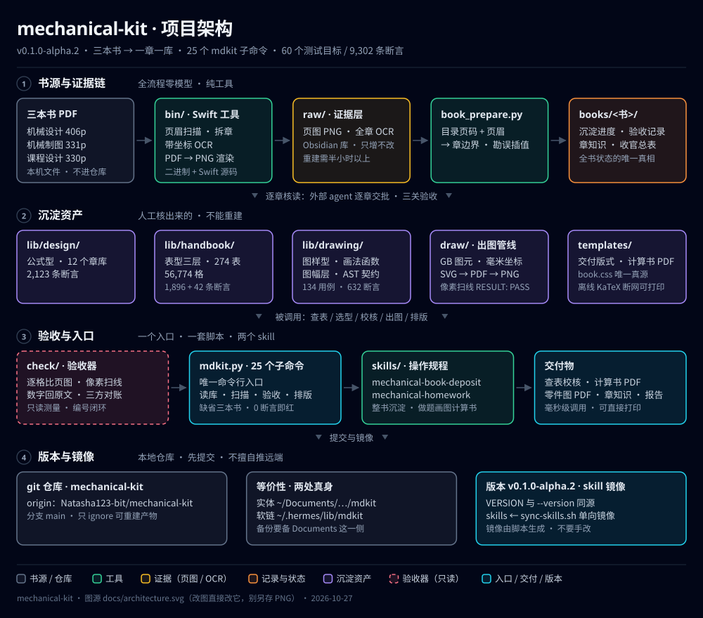

# mechanical-kit · v0.1.0-alpha.2

三本机械教材/手册 → **可调用的公式库、表字典、画法函数**。附带把它们拆出来的 OCR 工具链、
验收器，以及教 Hermes 怎么用这套东西的两份 skill。


> 一句话：**书在 PDF 里，能力在库里。** 想查「φ30 的平键多宽」「齿轮公差 7 级多少 μm」「轴怎么画」，
> 不用翻书，调函数或跑一条命令。

**许可**：代码 [MIT](LICENSE) · 数据 [CC BY-NC 4.0](LICENSE-DATA) · 数值来源与免责见 [NOTICE](NOTICE)。

## 架构



四个分区：**① 书源与证据链**（PDF → Swift 工具 → 页图/OCR → 拆章记录，全程零模型）→
**② 沉淀资产**（三本书三种形态，人工核读出来的，不可重建）→ **③ 验收与入口**（一个 `mdkit.py`、
一套测量脚本、两份 skill）→ **④ 版本与镜像**（git 仓库 + skill 单向镜像）。
图源就是 `docs/architecture.svg`，改图直接改它，不要另存位图（版本号也写在图里，跟着 `VERSION` 走）。

## 这是什么 / 不是什么

是：

- **公式库**：《机械设计》12 个章库，式号 = 函数名，例题当断言（2,123 条）
- **表字典**：《课程设计手册》274 个表号 / 56,774 格 + 273 条判据函数 + 标注串（1,896 + 42 条断言）
- **画法函数**：《机械制图》10 章 + 附录，图元 AST + 图幅层（134 用例 / 632 断言）
- **证据链**：每章 handoff 原始读数、逐批验收记录、sha256 快照——用来回头证明「这一格当年核过」

不是：不是教材电子版（PDF 不进仓库）、不是通用 OCR 框架（只服务这三本书的版式）、
不是机械设计软件（不替你做方案，只保证「查得到、算得对、画得像」）。

## 目录

| 路径 | 内容 | 丢了怎么办 |
|---|---|---|
| `mdkit.py` | **唯一入口**，25 个子命令（`mdkit.py help`）；`--version` 读 `VERSION` | 重写 |
| `lib/<书>/` | 沉淀主体：`<主题>_chNN.py` + `_tests.py`；表型书另有 `_lookup.py` / `_anno.py` / `_index.py` | **不能重建**（人工核几十小时） |
| `bin/` | arm64 小工具：`chmap` `pdfsplit` `ocrbox` `ocrpdf` `renderall` `pdftextlayer` + 同名 `.swift` | `swiftc` 重编 |
| `book/` | `book_prepare.py`（拆章总控，含 `ERRATA` 勘误表）、`assemble_sources.py` | 重写 |
| `check/` | 验收器：逐格 `verify_table_cells`、扫线 `verify_drawing_lines`、数字回原文 `verify_numbers`、跨页 `span_check`、三方对账 `index_diff`、编号闭环 `编号一致性` | 重写 |
| `draw/` | 出图管线：`gbdraw.py`（GB 图元，1 单位 = 1 mm）、`mech_frame.py`（说明书插图）、各章 `build.sh` | 重写 |
| `templates/` | 计算书 md→PDF（`book.css` 版式唯一真源）+ 离线 KaTeX | 重写 |
| `books/<书>/`（**仅开发版**） | 章地图、handoff 逐格读数、`沉淀进度.md` + `_批队列.md`、`验收记录.md`、章知识 | 部分不能重建 |
| `skills/` | 两份 skill 的**只读镜像**，改完跑 `./sync-skills.sh` | 从 `~/.hermes` 同步 |
| `lib/drawing/charter/` | 出图闸：L0 契约 + L1~L3 规则 + common/part + L4 注错反测；`fixtures/` 带底图与计算书 | 重写（闸是逐条判据，最费时） |
| `docs/` | 架构图（SVG 源码，可编辑） | 重画 |
| `VERSION` | 版本号唯一真源 | — |

## 三本书

| 书（短代号） | 形态 | 规模 | 现状 |
|---|---|---|---|
| 《机械设计》濮良贵 11 版 · `design` | 公式型：式号即函数名 | 406 页 / 第 1–15 章 / 12 个章库 | 已验收，2,123 条断言；ch10 图上系数已入库（4 类材料分图明确未实现） |
| 《机械设计课程设计手册》第 5 版 · `handbook` | 表型三层：表字典 / 判据函数 / 标注 | 330 页 / 21 章 / 274 表号 / 56,774 格 | 已签字，1,938 条断言；**已知缺口**：ch15 两条式未落函数（见收官总表 §九） |
| 《机械制图》丁一/钮志红 2012 · `drawing` | 图样型：画法函数 + 图幅层 | 331 页 / 10 章 + 附录 / 440 图 | 已验收，134 用例 / 632 断言，出图像素扫线通过 |

出处与偏移（页码怎么算、哪里缺页、哪里有错位块）只写在开发版的 `books/<书>/` 与 skill 的
`references/<书>/book.md` 里，本文不重复。

## 一分钟上手

```bash
MK=~/.hermes/lib/mdkit/mdkit.py        # 作者机；新机见下节

python3 $MK --version                  # mechanical-kit 0.1.0-alpha.2
python3 $MK selftest                   # 路径 + 二进制 + 三本书全部断言 + gbdraw，一把过
python3 $MK test all                   # 三本书 × 双解释器：60 个测试目标 / 9,302 条断言
python3 $MK list --book handbook       # 这本书有哪些章库
python3 $MK lib 10 --book handbook     # 打印某章的公开函数签名 + docstring 首行
```

做题/画图的口径（怎么取值、怎么写计算书、零件图怎么标）在两份 skill 里：
`~/.hermes/skills/engineering/mechanical-{book-deposit,homework}/`。

| 想干的事 | 命令 |
|---|---|
| 逐格核一张表对不对 | `mdkit.py tables <lib> <表名> <页图…>` |
| handoff 读数 ↔ 库逐格对账 | `mdkit.py audit handoff-ch04 key_ch04 …` |
| 文档 ↔ 磁盘对账（快照/断言/状态/契约） | `mdkit.py state handbook lib/handbook` |
| 表清单 ↔ 章库 ↔ 索引三方对账 | `mdkit.py index` |
| 式/表/图编号闭环 | `mdkit.py numbering` |
| 重出一章图并扫线 | `./draw/ch08/build.sh`（看 `RESULT: PASS`） |
| 计算书 md → PDF | `mdkit.py book 计算书.md --pdf` |
| 出图后过闸（四层 + 零件层） | `python3 lib/drawing/charter/check.py 图.svg --calc 计算书.json --fig-no CS2-01 --part shaft` |
| 闸自己看不看得见错 | `python3 lib/drawing/charter/mutants.py`（24 个注入，底图在 `charter/fixtures/`；要本地 Chromium 量文字框、G-13 要 fontTools，缺了会明确报出来） |
| 章程正文与条款表是否一致 | `python3 lib/drawing/charter/check_charter.py`（145 条，A 47 条） |

## 版本

- **唯一真源是 `VERSION`**（当前 `0.1.0-alpha.2`）：`mdkit.py --version`、本 README、架构图都跟它走。
- `0.x` 表示**还没到 1.0**：`alpha` = 主流程能跑通但接口未冻结，`lib/` 函数名与 `mdkit.py`
  子命令仍可能改（改了就升 `alpha.N`）。
- `alpha.1`：三本书沉淀完成、工具链一把过。
- `alpha.2`：**出图纸闸落地**——`lib/drawing/charter/` 四层（L0 契约 8 + L1~L3 29 + common 10 +
  轴/齿轮零件层 4/3 = 46 条规则）＋ 24 条注错反测；规则改挂 38 个真实章程条款（自动覆盖
  10 → 47 条 / 32.4%），`check_charter.py` 连「规则引用的条款存不存在、状态是不是 A」一起校验；
  底图与计算书进 `charter/fixtures/`，L4 不再依赖作者机目录。
- 发版动作：改 `VERSION` → `git tag -a v<版本> -m "…"` → 提交。**推远端由用户决定，不擅自 push**。

## 文档地图（只看需要的那份）

| 想知道 | 看这个 |
|---|---|
| 某章有哪些函数、参数与返回值 | `python3 mdkit.py lib 10 --book handbook`，或直接读 `lib/<书>/<主题>_chNN.py` 的 docstring |
| 某个用途对应哪张表 | `_index.找("轴承 安装尺寸")`、`_index.用途("轴径")`，或 `python3 mdkit.py index` |
| 这张表的数值当年怎么核的、哪里有存疑 | 该表 dict 的 `注` 字段（逐条写「照书存疑 / 跨页拼接 / OCR 误识纠正」） |
| 作图规范（线宽、图幅、尺寸标注口径） | `skills/mechanical-homework/references/` 的 `drawing-*.md` |
| 一批章节怎么沉淀、验收怎么过、踩过哪些坑 | `skills/mechanical-book-deposit/references/` 的 `book-deposit-playbook.md`、`acceptance-evidence.md`、`batch-operations.md` |
| 版本、发布、公开范围 | 同目录 `version-control.md` |

> 开发版另有 `books/<书>/` 一整套过程记录（进度表、批队列、逐格 handoff 读数、验收记录、sha256 快照）——
> 那是核读过程的证据，公开版不含，见上一节「这个仓库不含什么」。

## 安装到新机器

```bash
mkdir -p ~/.hermes/lib
git clone git@github.com:Natasha123-bit/mechanical-kit.git ~/.hermes/lib/mdkit
cd ~/.hermes/lib/mdkit && ./install.sh          # 标准布局：真身就放这里，没有软链
```

作者本机是另一种布局（真身在 `~/Documents/Hermes/Mechanical-Kit/mdkit`，`~/.hermes/lib/mdkit`
只是 symlink 入口，方便当开发者）→ 用 `./install.sh --dev-link`。脚本自己判定该走哪条路。

装完还要备三样（都不在 git 里）：

1. **原始 PDF**（三本，179 MB）：版面设计不公开，自备，放 `~/Documents/`
2. **页图与 OCR 源**：从 Obsidian vault 恢复 `机械知识库/raw/{assets,sources}/<书>/`
3. **`bin/` 是 arm64**：Intel 机要用同名 `.swift` 重新 `swiftc`；Chrome 出图链要本机 Chrome for Testing

验收：`python3 mdkit.py selftest` 全过、`./draw/ch08/build.sh` 出 `RESULT: PASS`。

## 这个仓库不含什么

仓库只放**能力**，不放**来源**——下面三类不在 git 里：

| 不在仓库 | 为什么 | 想用怎么办 |
|---|---|---|
| 三本教材/手册的 **PDF**（约 179 MB） | 版权归原出版者，且不该进 git | 自备，放 `~/Documents/<书名>.pdf` |
| **页图 + 全章 OCR 源**（Obsidian vault） | 那是出版者原页的扫描件 | 自备扫描/OCR；只查数值不需要页图 |
| **`books/` 的证据链**（逐格 handoff 读数、验收记录、sha256 快照） | 作者本机的核读过程记录，含本机路径与页图出处 | 不需要。某张表当年怎么核的，看章库里该表的 `注` 字段，或跑 `mdkit.py tables` |

所以：**clone 下来就能查表、选型、校核、出图、排计算书**；要复现「逐格核页图」那一步，得自己备 PDF 与页图。

副作用只有一处：没有 `books/` 时，`mdkit.py test all` 会跳过 5 个章库的「与 handoff 逐格等值」交叉核对（双解释器 **8,700 项**而不是 9,302，输出里标 `↷跳过 10`；机器上只有一个解释器时约为一半、四千多项），其余断言照跑，仍是全绿。

`.gitignore` 只排**可重建**产物：`draw/**/*.{png,svg,pdf,html,log}`（单章 3 分钟重建）、`books/**/_split/`（秒级重建）、`__pycache__/`、`.DS_Store`。

## 维护状态

个人项目：Issue 欢迎提（尤其**数值与原书不符**的，附页码与书影最好），但**不承诺响应时间**；PR 看情况合——改已验收章库的数值请附页图证据，否则一律按「照书存疑」处理（原书印错也按原样保留，见各表 `注`）。

## 自检

```bash
python3 mdkit.py paths                          # 代码里引用的路径是否都可解析
python3 mdkit.py selftest                       # 二进制 + 三本书断言 + 出图库
python3 mdkit.py state handbook lib/handbook    # 文档与磁盘快照是否一致
```

